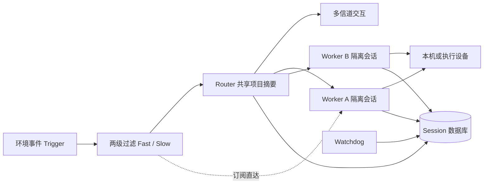

# SuperAgent

将钉钉和 Redmine 的明确请求转成项目任务，在独立代码目录中调用 Codex 分析、修改和验证，再由负责人核对产物、验收和批准回复。面向个人或共同信任项目资料的小团队。

2026-11-14 产品修订：按参考文章展示分支架构，默认配置收敛为本机 Agent、消息响应、交付方式三步。可直接选择本机已登录 Codex，查看每条事件真实 Router 判断和 Worker 会话，继续发言纠正。功能边界见 [架构与产品工作台](docs/架构与产品工作台.md)，最新检查见 [产品修订验收](docs/产品修订验收-20261114.md)。

历史 Python 演示预览可通过 `.\deploy\start-preview.ps1` 启动，通过 `.\deploy\stop-preview.ps1` 停止。演示数据位于 `data/preview-service`。

当前交付面向 Windows 本机、单服务进程和 SQLite。真实 Codex 修复演示、钉钉消息驱动的业务代码只读分析，以及 Redmine 工单和图片接收已经通过验收。自动化测试另使用受控假渠道验证故障与权限边界。当前验收范围及剩余事项以 [验收报告](docs/验收报告.md) 为准，不将容器配置等同于 Linux/PostgreSQL 运行验收。

## 启动工作台

日常开发和 Windows 交付均以 `main` 上的 TypeScript 版本为准。已安装实例通过安装目录下的 `SuperAgent.cmd Status` 查询实际地址。新安装、启动及数据目录见 [Windows 工作台说明](deploy/windows-ts/README.md)。

Python 3.12 服务保留作历史版本回切，操作见 [Python 回切说明](deploy/windows-ts/PYTHON-ROLLBACK.md)。

### 历史 Python 服务启动

需要 Python 3.12、Node.js 22、Git。仅在需要启动历史版本时，在仓库根目录执行：

```powershell
py -3.12 -m venv .venv
.venv\Scripts\python.exe -m pip install -r requirements-lock.txt
npm --prefix apps/web ci
npm --prefix apps/web run build
.\deploy\start.ps1
```

打开 <http://127.0.0.1:8765>。生产构建由 API 服务直接提供。停止使用 `.\deploy\stop.ps1`；脚本只停止自己记录的进程树。源代码、数据库、执行工作区与附件分别保存，升级前按 [运维说明](docs/运维与验收.md) 停机备份。

本机使用可在“管理设置 → 选择本机 Agent”中检测 Codex，点击“使用已有登录连接”。服务保存已选程序和账号目录，认证材料由 Codex 管理。原专用账号启动脚本仍可使用：`.\deploy\start-local.ps1 -CodexExecutable '<Codex 可执行文件绝对路径>'`，数据库为 `data/workbench.db`；专用登录入口是 `.\deploy\login-codex.ps1 -CodexExecutable '<同一路径>'`。部署脚本使用 UTF-8 BOM，兼容 Windows PowerShell 5.1。

默认关闭任务调度、真实渠道连接和对外发送。本机无访问令牌时仅允许回环访问；多人访问须配置 `SUPERAGENT_API_TOKEN` 或 `SUPERAGENT_USERS_JSON`，经 HTTPS 登录。浏览器持有 HttpOnly 会话，不把管理员令牌打包到页面。整个实例是共同授权空间，不作为互不信任租户之间的保密边界。

## 完成首次配置

1. 在“管理设置”选择已登录的本机 Codex。验证为 ChatGPT 订阅账号后可直接使用，无需填密钥或虚构单次金额。API 按量账号继续使用高级预算准入与对账。
2. 在“项目设置”建立工作项目。文字答复只需已有本地目录；代码分析和修复需要干净的 Git 仓库，修复还需基线分支、允许修改范围和测试命令，执行使用独立克隆。
3. 选择私聊是否回复、群聊响应范围和私聊默认项目。钉钉需要已登录 DWS profile、当前账号标识以及外部发送者授权；缺少授权会进入待确认并展示实际原因。已保存新策略后支持私聊与群聊同时监听，界面分项显示实际接收状态。
4. 选择“只生成草稿”或“批准后可发送”。保存策略不启动真实消息监听；在连接状态中明确开启。原渠道发送仍需要逐条批准和外部交付开关。

模型、并发、预算、身份管理与外部客户端桥接集中在高级设置。账号额度由 Codex 服务校验；按量账户预留是准入估算，未取得真实费用时保留待对账记录。

连接器具体字段、认证与恢复流程见 [治理交接](docs/handoffs/governance.md)、[消息接入交接](docs/handoffs/connectors.md) 和 [运行时交接](docs/handoffs/runtime.md)。凭据不写入项目配置、源码或测试文件。

## 日常处理流程



任务可补充要求、改方向、暂停或取消。修改目标会使旧版本的结果与审批失效。修复只有在实际差异和当前代码的测试证据齐全后才能进入待验收；模型返回“完成”并不直接改变为已完成。

明确“仅分析／不修改代码”的请求进入只读分析模式，通过受限的文件列表、文件读取和文本搜索获得依据，不要求运行修复测试，也不允许批准扩大执行权限；工作区发生变化时不能验收。读取错误、拒绝访问、截断和覆盖范围保留在证据中。意图矛盾的消息进入待确认。测试群使用当前账号监听时会过滤该账号自己发送的消息，测试应由另一名成员发起。

来源附件在受管目录中下载并检查范围、大小、格式和哈希；图片传给 Codex，文本有长度限制。附件内容只是资料，不授予修改目录或对外发送权限。PDF 能否由执行环境读取须在结果中说明。

遇到断连、超时或重启，运行结果未知时停止自动重做。核验进程与产物后在任务详情对账，再决定继续或放弃。回复发送结果未知时对账外部渠道，不重复发送。预算费用也有独立对账入口。

## 开发与验证

TypeScript 后端使用 Node.js 24，工作台使用同一版本。Windows PowerShell 在仓库根目录执行：

```powershell
npm ci
npm test
npm run build
npm --prefix apps/web ci
npm --prefix apps/web test
npm --prefix apps/web run build
```

测试全部使用临时项目、数据库和假渠道。不要将测试通过解释为真实钉钉、Redmine、Codex 账号或 PostgreSQL 已验收。Windows 测试需要允许本机回环通信及创建测试子进程。

- `apps/server`：TypeScript 控制服务、任务、权限、路由与交付。
- `packages`：SQLite 存储、Codex 运行时、渠道和 Windows 进程管理。
- `apps/web`：中文工作台。
- `deploy/windows-ts`：Windows 安装、启停与回切。
- `tests`：模块、跨模块、HTTP 黑盒与审查回归。

首版只支持单个控制服务进程，不使用多副本领取任务。默认不合并代码、不推送、不部署业务系统、不修改真实业务数据；修复产物在任务工作区中，交付动作由负责人明确决定。

## 设计与交付记录

- [产品设计](docs/SuperAgent-产品设计文档.md)
- [技术执行设计](docs/SuperAgent-技术执行文档.md)
- [实施基线](docs/实施基线.md)
- [接口契约](docs/接口契约.md)
- [开发进度及模型分工](docs/开发进度.md)
- [运维与验收](docs/运维与验收.md)
- [总控验收报告](docs/验收报告.md)
- [真实渠道验收记录](docs/真实渠道验收记录.md)
- [真实 Codex 验收记录](docs/真实Codex验收记录.md)

历史工作包的分工和验收记录见上方文档。
