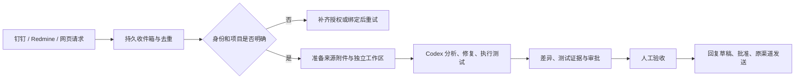

# SuperAgent

将钉钉和 Redmine 的明确请求转成项目任务，在独立代码目录中调用 Codex 分析、修改和验证，再由负责人核对产物、验收和批准回复。面向个人或共同信任项目资料的小团队。

当前交付面向 Windows 本机、单服务进程和 SQLite。真实 Codex 修复演示、钉钉消息驱动的业务代码只读分析，以及 Redmine 工单和图片接收已经通过验收。自动化测试另使用受控假渠道验证故障与权限边界。当前验收范围及剩余事项以 [验收报告](docs/验收报告.md) 为准，不将容器配置等同于 Linux/PostgreSQL 运行验收。

## 启动工作台

需要 Python 3.12、Node.js 22、Git。Windows PowerShell 在仓库根目录执行：

```powershell
py -3.12 -m venv .venv
.venv\Scripts\python.exe -m pip install -r requirements-lock.txt
npm --prefix apps/web ci
npm --prefix apps/web run build
.\deploy\start.ps1
```

打开 <http://127.0.0.1:8765>。生产构建由 API 服务直接提供。停止使用 `.\deploy\stop.ps1`；脚本只停止自己记录的进程树。源代码、数据库、执行工作区与附件分别保存，升级前按 [运维说明](docs/运维与验收.md) 停机备份。

本工作区已配置的本机实例使用 `.\deploy\start-local.ps1 -CodexExecutable '<Codex 可执行文件绝对路径>'` 启动，数据库为 `data/workbench.db`。专用登录入口是 `.\deploy\login-codex.ps1 -CodexExecutable '<同一路径>'`；它只为 `data/codex-state` 登录，退出脚本后恢复原有环境变量。部署脚本使用 UTF-8 BOM，兼容 Windows PowerShell 5.1。

默认关闭任务调度、真实渠道连接和对外发送。本机无访问令牌时仅允许回环访问；多人访问须配置 `SUPERAGENT_API_TOKEN` 或 `SUPERAGENT_USERS_JSON`，经 HTTPS 登录。浏览器持有 HttpOnly 会话，不把管理员令牌打包到页面。整个实例是共同授权空间，不作为互不信任租户之间的保密边界。

## 完成首次配置

1. 在“项目”中绑定本地 Git 根目录、本地基线分支及测试命令。源仓库必须干净；执行使用独立克隆，不覆盖源目录。`allowed_paths` 使用仓库相对路径；空列表不允许改动，`.` 代表整个仓库。该范围是审批与产物验收门槛，不是操作系统对子目录的隔离。
2. 为执行服务配置 `SUPERAGENT_CODEX_EXECUTABLE` 和专用 Codex 运行环境，按运行时交接记录完成认证。设置模型与推理强度，默认 `gpt-6.1-sol / medium`。
3. 在管理设置中设置全局预算及正数单次预留，确认后启用调度。预算预留是准入估算；Codex 未提供可验证费用时保留待对账记录，不把估算作为实际花费。
4. 在项目中填钉钉群标识或 Redmine 项目标识；在身份授权中将外部账号映射到本实例用户，显式授予目标项目的 `request` 权限。
5. 配置连接器并在测试范围启用。无法确定身份、项目或意图的消息进入收件箱，修正映射后重新路由。Redmine 使用环境变量引用 API key；钉钉使用已登录的 DWS profile。

连接器具体字段、认证与恢复流程见 [治理交接](docs/handoffs/governance.md)、[消息接入交接](docs/handoffs/connectors.md) 和 [运行时交接](docs/handoffs/runtime.md)。凭据不写入项目配置、源码或测试文件。

## 日常处理流程



任务可补充要求、改方向、暂停或取消。修改目标会使旧版本的结果与审批失效。修复只有在实际差异和当前代码的测试证据齐全后才能进入待验收；模型返回“完成”并不直接改变为已完成。

明确“仅分析／不修改代码”的请求进入只读分析模式，通过受限的文件列表、文件读取和文本搜索获得依据，不要求运行修复测试，也不允许批准扩大执行权限；工作区发生变化时不能验收。读取错误、拒绝访问、截断和覆盖范围保留在证据中。意图矛盾的消息进入待确认。测试群使用当前账号监听时会过滤该账号自己发送的消息，测试应由另一名成员发起。

来源附件在受管目录中下载并检查范围、大小、格式和哈希；图片传给 Codex，文本有长度限制。附件内容只是资料，不授予修改目录或对外发送权限。PDF 能否由执行环境读取须在结果中说明。

遇到断连、超时或重启，运行结果未知时停止自动重做。核验进程与产物后在任务详情对账，再决定继续或放弃。回复发送结果未知时对账外部渠道，不重复发送。预算费用也有独立对账入口。

## 开发与验证

```powershell
.venv\Scripts\python.exe -m pytest tests -q
npm --prefix apps/web test
npm --prefix apps/web run build
```

测试全部使用临时项目、数据库和假渠道。不要将测试通过解释为真实钉钉、Redmine、Codex 账号或 PostgreSQL 已验收。Windows 测试需要允许本机回环通信及创建测试子进程。

- `superagent/core`：持久任务、调度、预算、权限、路由和交付账本。
- `superagent/runtime`：Codex 协议、工作区和执行证据。
- `superagent/connectors`：钉钉、Redmine、附件与历史恢复。
- `apps/web`：中文工作台。
- `deploy`：Windows 启停、Compose 配置、备份与恢复。
- `tests`：模块、跨模块、HTTP 黑盒与审查回归。

首版只支持单个控制服务进程，不使用多副本领取任务。默认不合并代码、不推送、不部署业务系统、不修改真实业务数据；修复产物在任务工作区中，交付动作由负责人明确决定。

## 设计与交付记录

- [产品设计](docs/SuperAgent-产品设计文档.md)
- [技术执行设计](docs/SuperAgent-技术执行文档.md)
- [实施基线](docs/实施基线.md)
- [接口契约](docs/接口契约.md)
- [开发进度及模型分工](docs/开发进度.md)
- [运维与验收](docs/运维与验收.md)
- [总控验收报告](docs/验收报告.md)
- [真实渠道验收记录](docs/真实渠道验收记录.md)
- [真实 Codex 验收记录](docs/真实Codex验收记录.md)

六周工作包已拆给七个并行会话，由主会话集中审查、整合和提交。仓库为本地 Git 仓库；远端地址尚未配置。
