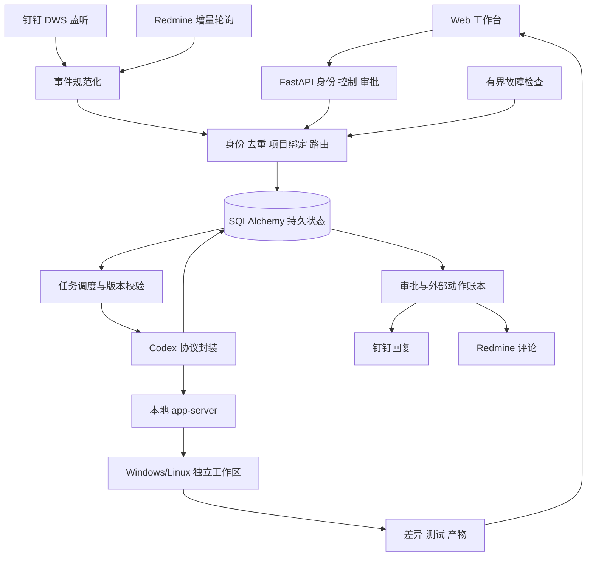

# SuperAgent 技术执行文档

版本 v0.2　日期 2026-11-13　状态为目标设计，待开发验证与真实接入验收

关联文档包括 [产品设计文档](./SuperAgent-产品设计文档.md)、[实施基线](./实施基线.md) 和 [接口契约](./接口契约.md)。模块实现与接口调整由总控协调。

## 1 建设目标与范围

首版闭环为钉钉 @本人或授权群内明确请求、Redmine 指派／评论变化 → 固定项目目录和基线分支 → Windows/Linux 本地独立工作区 → Codex app-server 分析、修改、验证 → 证据与回复草稿 → 有效授权后回复原渠道 → 人工验收。执行过程中持续接收补充和控制消息。

| 阶段 | 交付范围 | 验收边界 |
| --- | --- | --- |
| P0 | Web、钉钉、Redmine、Windows/Linux 本地 Codex，持久任务、隔离工作区、审批、恢复和验收 | 个人／受信任小团队，一个共享授权空间，默认最多 4 个并发任务 |
| 可选适配 | GitHub Issue/PR/CI | 单独配置权限和验收，核心闭环可独立运行 |
| P1 | 无明确请求时的白名单主动分析、低优先级隔离草稿、更多设备 | 独立限额和价值评估 |
| 后续 | 多租户、跨实例协作、弹性执行环境 | 依据实测和新增授权立项 |

业务恢复任务先交付方案。自动合并、上线、修改真实业务数据库和删除真实数据均在首版能力范围之外。Agent 自身的崩溃恢复按运行账本处理。开发遵守工作区约定，使用模拟服务验证，真实账号监听默认关闭。

试点负载假设为 1～5 位受信任成员、1～3 个项目、4 个并发任务。延迟、容量、成功率及六周工作量均为待验证目标。接收确认目标 p95 ≤2 秒，已有任务事件直通目标 p95 ≤1 秒，正常负载下路由结果目标 p95 ≤15 秒。暂停／取消目标在持久接收后 2 秒内撤销后续动作许可，执行实际终止单独测量。

## 2 系统结构与职责



控制层承担任务关联、权限、审批、版本、调度和对外动作。逻辑 Router 优先使用明确引用和确定性规则，歧义交人澄清。执行层通过 Codex 处理代码任务。Delivery 统一发送已授权具体内容，运行时仅回传事件和证据。接入器作为可禁用后台服务，按配置启动，配置与秘密分别管理。

Codex 自有推理与工具生命周期由 app-server 管理。控制层围绕其协议请求、thread/turn、审批和实际结果持久对账。所有控制层可见的外部业务写入都经过确定性授权。Codex 进程使用的系统账号、网络、插件及 MCP 配置也需受约束，避免其绕过 Delivery 持有外发凭据。

## 3 技术选型与工程目录

| 层 | 首版设计 | 运行要求 |
| --- | --- | --- |
| API | Python 3.12、FastAPI、Pydantic | HTTP 保持短事务，长任务由调度器推进 |
| 前端 | Node 22、React、TypeScript、Vite | 任务、事件、审批和连接状态均来自 API |
| 持久化 | SQLAlchemy | 开发 SQLite 单进程，部署 PostgreSQL |
| 执行引擎 | 本地 Codex app-server，stdio JSON-RPC | 配置可执行文件、工作目录、模型及受限执行策略 |
| 接入 | DWS 结构化消息、Redmine HTTP | 持久游标、分页、有界重试、回流过滤 |
| 产物 | 受控本地目录与数据库元信息 | hash、版本、鉴权下载与保留策略 |
| 验证 | pytest、离线假协议进程、假外部服务、前端构建及端到端检查 | 真实联调独立记录 |

```text
superagent/
  main.py
  api/                 HTTP 与 SSE
  core/                状态、权限、SQLAlchemy、调度、审批、账本
  runtime/             Codex 协议与工作区管理
  connectors/          钉钉和 Redmine
apps/web/              任务工作台
tests/core/
tests/runtime/
tests/connectors/
tests/e2e/
deploy/                启动、部署、备份与恢复
docs/handoffs/         模块交付及待集成接口
```

SQLite 用于单进程功能和恢复开发。多进程领取、事务竞争和部署迁移需在 PostgreSQL 单独验证。启动执行迁移与恢复检查，先对账在途任务，再开放新调度。锁只覆盖本地状态事务，外部调用在事务之外进行。PostgreSQL 队列可使用行锁与原子领取，具体方案需通过并发验收。

## 4 数据模型与一致性

| 对象 | 关键内容 | 约束 |
| --- | --- | --- |
| Project | id、repo_path、base_branch、allowed_paths、test_command、来源群和 Redmine project ID | 管理员配置，消息正文不能指定任意路径或命令 |
| Identity | 渠道 actor ID、本地用户、角色、项目权限 | 可信绑定，显示名与自称不构成授权 |
| Event | source、external_id、thread_id、issue_id、content、发生／接收时间 | 来源去重、保留编辑版本和原始引用 |
| Task | 共享契约字段、负责人、验收条件、控制请求 | revision 管目标，state_version 管并发，control_version 管控制许可 |
| Run | task_id、attempt、所有者、租约、输入游标、版本快照 | 同一任务仅一个活动执行所有者 |
| RuntimeRequest | 外部请求 ID、连接代次、method、参数 hash、thread/turn、发送与响应状态 | ID 关联响应，重连后请求处置先对账 |
| RuntimeEvent | thread/turn/item、server request ID、接收游标、原始事件引用 | 事件可能迟到或重复，按可用标识去重并检查任务版本 |
| Approval / Grant | action_hash、revision、目标、内容 hash、有效期、授权人、撤销版本 | 内容或目标变更使旧审批失效 |
| ExternalAction | 目标渠道／对象、动作 hash、状态、外部对象 ID、尝试和对账记录 | 发送前入账，超时转 unknown |
| Artifact | task_id、revision、base SHA、diff、hash、测试引用、未验证项 | 不可变快照，新产物单独版本 |
| Notification / Audit | 里程碑、revision、渠道、操作者、证据 | 去重、脱敏、附加记录 |

任务创建、事件关联、派生队列和 outbox 应尽可能在同一数据库事务提交。只有持久化成功才确认接收。消费者游标与处理结果共同提交，避免游标领先业务落库。每任务串行消费自身事件，跨任务共享可写资源另行加锁。

数据库事务只覆盖控制服务。Codex 内部 shell、文件变更和远端服务均处于事务外。请求 ID 负责关联，不能证明副作用恰好一次。发送前后崩溃、响应丢失及恢复均需核对会话、工作目录和外部对象。结果无法确认时保持 unknown，阻止自动重复写入并请求人工核对。

## 5 接入、身份与任务路由

统一输入字段为 `{source,external_id,event_type,actor_id,thread_id,project_external_id,issue_id,content,occurred_at,attachments:[],metadata:{}}`。控制层接收后补充本地 ID、可信身份和接收时间，正文保持不可信输入。

### 5.1 钉钉

监听 DWS NDJSON，处理启动 ready、异常退出和有界重连。来源群须已绑定项目，且满足 @本人或明确请求准入。自身机器人消息、系统发送回执和历史重复消息仅作为对账资料。无独立串时依赖回复关系、任务链接和明确选择，群 ID 只确定来源范围。

### 5.2 Redmine

按 project ID 与配置用户查询指派／评论增量，处理分页、更新时间边界、相同时间的多条数据和评论 journal 标识。游标只在 emit 已持久接收后推进，重叠扫描依靠事件唯一键消除重复。首次启用需明确回溯范围，历史评论可归档，触发执行仍须满足准入与授权。

### 5.3 关联与持续跟进

显式 task ID、问题映射和回复串优先。新事件无法确定归属时进入 waiting_input，展示候选。已订阅事件直接进入对应任务收件箱。暂停、取消、撤权、改方向优先处理。其他参与者建议保留待决策，权限由服务端判定。

已完成或取消的任务接到新需求时另建关联任务，保留原验收。可选 GitHub 适配另做验签、来源白名单和版本匹配，旧提交 CI 只归档历史。

## 6 Codex app-server 集成

内部封装遵循《接口契约》的 `CodexAppServer`，包括 start、start_thread、resume_thread、start_turn、steer_turn、interrupt_turn、events、respond_approval 和 close。底层方法、参数和审批响应以本机安装版本生成的 schema 核验，记录版本与能力清单。

每条连接先完成 initialize／initialized，再创建或恢复 thread。start_turn 前持久保存输入、目标和控制版本，返回后保存 thread/turn ID。进程输出由独立读取协程持续消费，响应按请求 ID 关联，服务端审批请求进入可审阅队列，终态通知驱动本地对账。stderr、未知通知和解析失败均有有界日志和明确诊断。协议生命周期依据官方说明。[Codex App Server](https://learn.chatgpt.com/docs/app-server)

| 场景 | 控制层行为 |
| --- | --- |
| 新任务 | 建独立工作区，创建 thread，保存 ID，启动 turn |
| 普通补充 | 先落事件，活动 turn 可 steer，空闲时新 turn |
| 改方向 | 增加 revision/control_version，失效旧审批，请求中断后按新目标推进 |
| 需要 Codex 审批 | 保存 server request ID、连接代次、具体动作、版本及权限快照，审批决定再次核验后回复 |
| 连接中断或进程退出 | 停止新调度，保存未知状态，恢复既有 thread 并核对历史和实际目录 |
| turn 结束 | 检查状态、差异、验证结果及未知动作，证据齐备才进入 review_ready |

Codex 审批和外部消息审批各自绑定具体动作。重连后旧 request ID 的审批不能直接发送到新连接。迟到结果可以作为历史证据，当前版本、权限和租约检查通过后才允许推进。

模型及推理强度由项目配置与实际可用能力确定，执行封装负责传递受支持参数并记录配置。首版不另建 ProviderAdapter 推理工具循环。高强度用于复杂修复与恢复分析，简单归属优先规则。账户权限、费用和可用模型在真实联调中核验。

## 7 状态、控制、工作区与接管

统一状态为 queued、running、waiting_input、waiting_approval、waiting_resource、paused、review_ready、completed、failed、cancelled。默认由负责人或管理员人工验收。重试创建新的 attempt，completed/cancelled 的新需求另建关联任务。

暂停、取消先递增 control_version 并拒绝新调度和新审批，再请求 turn 中断。请求受理后展示处理中，待运行状态与在途外部动作核对完成才显示 paused/cancelled。协议中断确认后仍需核对文件和已发生的外部副作用。设备离线、进程状态未知或不可中断操作持续时保留停止待确认。对单一共享 app-server 终止进程可能影响其他任务，进程归属必须可追踪。

恢复检查最新 revision、授权、环境和原 thread/turn，先消费已知结果。租约过期触发恢复检查，旧进程未确认停止前不能在同一可写目录启动替代任务。新控制代次不会重新激活旧审批或旧发送动作。

`prepare_workspace(repo_path, base_branch, task_id, workspaces_root)` 校验真实路径、Git 状态、基线与未提交修改，返回 path/base_sha/branch。工作区与产物路径受允许根目录约束，覆盖符号链接及 Windows junction 逃逸。固定分支来自管理员配置，外部正文中的目录和分支仅作待核实资料。

每任务使用独立 clone 或受管理 worktree，保留原目录。Git 工作树隔离的权限边界需结合系统账号、Codex 策略和部署隔离措施验证。凭据、SSH Agent、任意宿主目录和 Docker socket 按最小能力配置，测试脚本和仓库说明均不能扩权。Windows 验证编码、空格路径、进程树及终止状态，Linux 验证进程组、文件权限和相同恢复边界。

人工接管先冻结写入，核对在途状态，再导出基线、补丁、新文件、测试、hash 和未完成清单。未知状态只导出标记不完整的快照。人工完成后提供允许仓库中的确切 SHA，校验归属和差异，在新目录载入，明确恢复后产生新 revision 并重验。接管导出／导入的专用 API 属待总控扩展契约，首版界面不可假定已有接口。

## 8 上下文、授权与对外交付

上下文沿 Event → 讨论 → Task → Run/Artifact 保留来源引用。摘要带时间与版本，原始用户目标单独保存。每次读取校验权限，清理内容显示明确状态。只展示工作摘要、工具动作和证据，隐藏推理无需保存。

admin 管理项目、身份、连接、持续授权和额度；member 可创建任务和建议，负责人可控制和验收自身任务；viewer 只读脱敏材料。批准外部动作还需位于管理员授予的批准范围。共享空间仅接入成员可共同访问的项目，独立保密边界使用独立实例。

Grant 指定项目、动作、目标、内容范围、执行环境、期限及授权人。已有有效授权直接使用，超范围、过期、撤销或内容变更才重新申请。单次 action_hash 绑定目标渠道／对象、正文 hash、产物 hash、revision、基线和有效期。拒绝后保留原因。

先固化分析、差异、测试报告和回复草稿，再校验授权并写 ExternalAction，最后调用连接器。返回外部对象 ID 后记成功；超时记 unknown，先查询现有消息／评论。平台无法可靠确认时交人核对，禁止盲目补发。可选 Git 发布按推送、建 PR、评论分别记账，保留部分完成状态。

通知唯一键为 task_id＋milestone＋revision＋channel。默认只在原入口发送关键阻塞、需要决定和交付消息，普通过程留工作台。同故障聚合，默认每 30 分钟至多一次提醒；静默时段与例外由管理员配置。首次接收确认同样须有对应消息授权。

## 9 HTTP 与前端契约

服务入口为 `superagent.main:app`，默认地址 `http://127.0.0.1:8765`，业务 API 前缀 `/api/v1`。JSON 使用 UTF-8，时间使用 UTC ISO8601，错误为 `{ "detail": "可读说明" }`。完整字段以《接口契约》为准。

| 接口 | 请求或返回 |
| --- | --- |
| GET /health | status、version |
| GET /api/v1/overview | counts、active_tasks、pending_approvals、connectors |
| GET/POST /api/v1/projects，PATCH /api/v1/projects/{id} | 项目配置；test_command 仅管理员配置 |
| GET/POST /api/v1/tasks | 查询支持 status/project_id；创建含 title、goal、project_id、acceptance_criteria?、source? |
| GET /api/v1/tasks/{id} | task、events、artifacts、approvals |
| POST /api/v1/tasks/{id}/messages | content、change_goal、expected_state_version? |
| POST /api/v1/tasks/{id}/controls | action 为 start/pause/resume/cancel/retry、expected_state_version? |
| POST /api/v1/tasks/{id}/acceptance | accepted、comment?、revision |
| GET /api/v1/approvals | 审批数组 |
| POST /api/v1/approvals/{id}/decision | decision 为 approve/reject、action_hash |
| GET /api/v1/connectors | configured、enabled、status、last_error、last_seen 等状态 |
| GET/PATCH /api/v1/settings | 脱敏读取；只写非秘密配置 |
| GET /api/v1/artifacts/{id} | 鉴权文件／内容，路径由服务端解析 |
| GET /api/v1/events/stream | SSE；前端可有界轮询 |
| POST /api/v1/events | 内部／本地测试注入；部署需管理员身份 |

任务必需字段包括 id、title、goal、project_id、status、revision、state_version、control_version、source、source_ref、created_at、updated_at、last_error、codex_thread_id、codex_turn_id、workspace_path。版本冲突应拒绝并要求重新读取。对外部署必须落实名确身份认证及写入保护，本机默认配置的信任范围须在运行说明中列清。

界面导航为工作台、任务、项目设置、运行状态。任务详情展示来源、目标、状态、版本、事件、审批动作快照、差异、验证与未验证事项。网络失败保留输入草稿，停止待确认与已停止分别展示。工作台和连接状态不得用假数据替代真实 API；demo 必须明确标记。

## 10 Watchdog、预算与观测

Watchdog 依据进程状态、心跳、最后事件和实际证据诊断。waiting_input、waiting_approval、paused 不按停滞处理。正常长测试标注预计时间，单纯长时间无消息先诊断。外部错误指数退避且有上限，同原因恢复默认每任务每小时最多 3 次，随后交人。

预算涵盖任务／日额度、并发数、turn 数、运行时间、输出量和磁盘。协议能提供的 token 用量与模型配置按实际记录，缺失费用记估算或待对账。Codex 内部调用细节和费用可能无法精确预留，控制层在可观察边界限制新增 turn，额度触发后请求中断并报告在途消耗。不可把控制服务计数当作模型实际调用次数。

日志携带 event_id、task_id、run_id、外部请求 ID、thread/turn ID、action ID。记录接收延迟、队列年龄、等待原因、未知请求／动作、审批等待、通知抑制和人工验收结果。凭据与敏感源码脱敏，诊断日志按权限读取。

## 11 验证与发布门槛

以下全部为验收计划。离线测试、真实 Codex、真实渠道和业务验收分别记录结果。

| 编号 | 场景 | 判定依据 |
| --- | --- | --- |
| T-01 | 钉钉明确请求、Redmine 指派／评论持续跟进 | 正确绑定同一任务，改方向后旧审批失效 |
| T-02 | 4 任务并发，第 5 项排队 | 目录和上下文隔离，接收不阻塞 |
| T-03 | 重复、乱序及回流事件 | 唯一入库与业务消费，游标不丢事件，自身消息不循环 |
| T-04 | 相似目标、未知归属 | 提供澄清，保留纠正历史 |
| T-05 | 运行中暂停、取消、迟到审批 | 后续许可撤销，真实终止待确认，旧请求不复活 |
| T-06 | 改方向、撤权后旧 turn 回包 | 保存历史，阻止旧结果发布和覆盖新版本 |
| T-07 | 发送前后崩溃、stdout 丢失、app-server 重启 | 恢复原 thread/turn 并核对实际目录，未知副作用不盲目重试 |
| T-08 | 钉钉／Redmine 写成功但响应丢失 | 外部动作账本与平台对象对账，未知状态可人工处理 |
| T-09 | 身份伪造、注入、路径／junction 逃逸 | 拒绝越权与秘密泄露 |
| T-10 | 审批后改变内容、目标或 revision | action_hash 失配，旧批准拒绝 |
| T-11 | 重复通知、静默时段、持续故障 | 通知聚合且有授权，无普通过程刷屏 |
| T-12 | 长正常任务、重复失败循环 | 有界诊断恢复，正常任务不误判已停 |
| T-13 | 额度与并发竞争 | PostgreSQL 原子控制，已知与估算消耗明确 |
| T-14 | 备份恢复 | 引用、hash、审批、会话与外部动作先对账 |
| T-15 | 至少 5 个真实代码任务，含失败恢复 | 差异、验证、未验证项、人工验收齐全 |
| T-16 | Windows/Linux 路径、编码、进程与断线 | 各平台独立记录结果，未知状态展示真实 |
| T-17 | 人工接管与导入 | 冻结、完整快照、归属检查、新版本重验 |
| T-18 | 主动候选，P1 | 低优先级、独立预算、无授权外发拦截 |

纯规则和 API 测试覆盖状态、身份、授权、乐观锁及动作 hash。假 Codex 进程测试乱序响应、通知、server request 审批、断连和中断；假外部服务测试分页、游标、超时未知结果。PostgreSQL 验证并发、迁移与恢复。前端完成构建和真实 API 端到端检查。产品 AC-01～15 逐项对照上表，PRD-12 纳入 P0，PRD-11 对应 P1 T-18。

## 12 六周工作包与并行集成

六周为原工作量规划，可按依赖并行。各模块只修改所有权目录，交付记录写入自己的 handoff，总控负责跨模块接口、集成、验收和中文 Git 提交。

| 工作包 | 交付 | 质量门 |
| --- | --- | --- |
| ENG-01/02 | 工程、共享契约、持久状态、身份和控制 | 持久 API、迁移、版本冲突与负向测试 |
| ENG-03 | 工作台、任务、项目与连接状态 | 真实 API、错误态和前端构建 |
| ENG-04/05 | 钉钉／Redmine、事件路由与订阅 | 去重、游标、身份、准入和歧义处理 |
| ENG-06/07 | Codex 协议、Windows/Linux 独立工作区 | 假协议故障测试、真实本机代码闭环 |
| ENG-08/09 | 产物、审批、授权回复与通知 | 版本绑定、未知写对账和人工验收 |
| ENG-10/11 | Watchdog、预算、权限及恢复 | 并发、迟到结果、故障注入和数据库验证 |
| ENG-12 | 部署、备份恢复、真实联调与验收记录 | 产品 AC、真实渠道和真实 Codex 状态分别确认 |

关键依赖为事件持久化 → 可信任务与项目绑定 → Codex/工作区 → 证据与审批 → 授权回复与人工验收 → 恢复演练。模块依赖未就绪时按共享契约开发假协议测试，集成后重新验证正常入口。

## 13 部署、备份与待验证事项

开发默认 SQLite 单进程，API 本机监听，连接器和真实执行显式配置。部署采用 PostgreSQL、持久产物目录和受控服务身份，可在 Windows/Linux 运行控制服务与本地执行引擎。远端 Windows 设备接入云控制面的传输、身份和恢复协议需另做契约，首版部署不能假定已提供远端 WSS Runner。

启动检查迁移、路径、Codex 可执行文件与协议能力、接入状态和待恢复任务。升级先停止新调度，处理在途 turn 和未知动作，再更新应用。回退使用兼容数据库的应用版本，恢复后先对账外部对象及本地工作区。

备份覆盖数据库、产物、配置引用和恢复所需 Codex 本地会话资料，秘密仍由本机凭据机制管理。每日一致性备份的初始目标为 RPO ≤24 小时、RTO ≤4 小时，需演练证实。恢复期间暂停外部发送，避免恢复出的 outbox 重复发布。默认日志和原始事件 30 天、摘要／产物／审批审计 90 天，清理后保留引用失效说明。

主要待验证项为本机 Codex schema 兼容、账户可用模型与费用、Windows/Linux 限权与终止语义、DWS 实际消息字段、Redmine 时间边界与分页、平台写入对账能力、PostgreSQL 并发和真实任务质量。实施和测试完成状态以 handoff 与验收记录为准。
