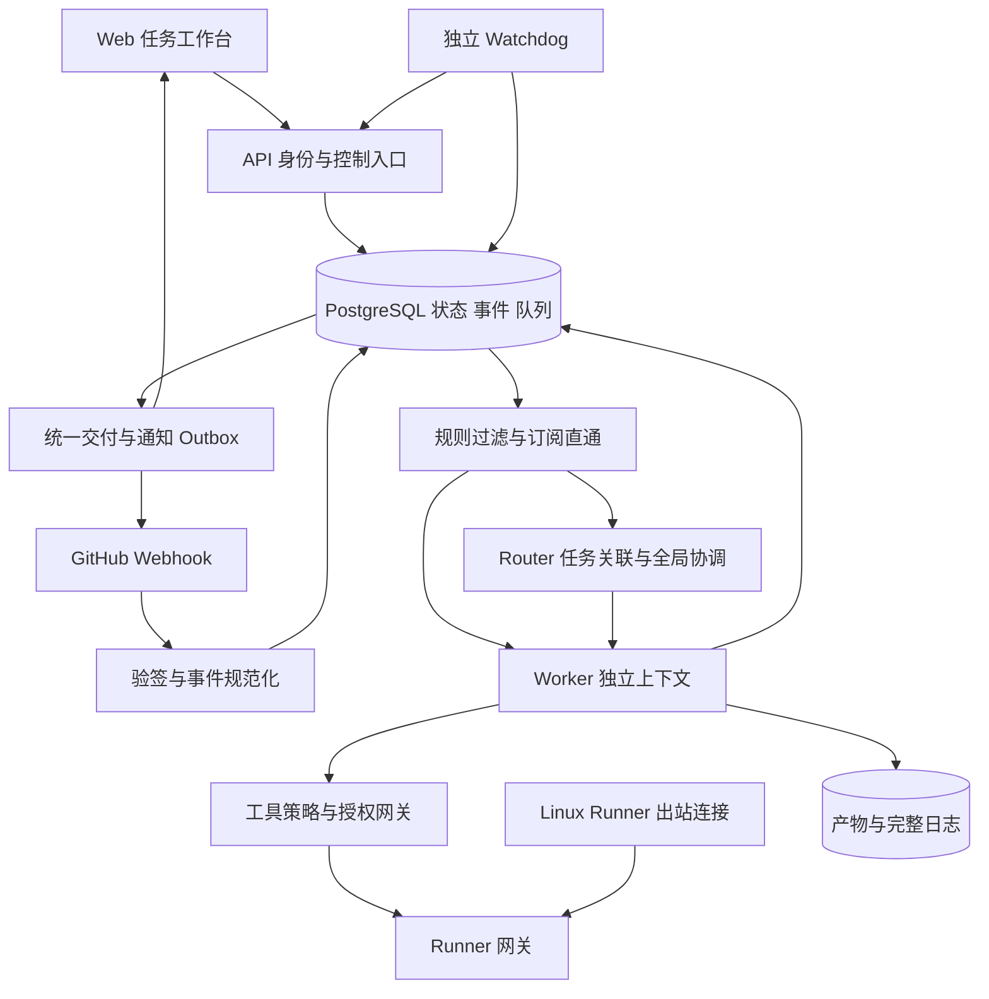

# SuperAgent 技术执行文档

版本：v0.1　日期：2026-11-13　状态：研发实施基线，待试点验证

关联文档：[SuperAgent 产品设计文档](./SuperAgent-产品设计文档.md)

## 1 建设目标与实施边界

面向个人和小团队研发协作，将持续接收工作事件、并行执行、跨信道衔接和可恢复运行形成一个闭环。首版要证明：用户从 Web 提出修复任务，系统在独立环境完成分析和验证，经授权创建 GitHub PR；用户随后在 PR 提出调整，系统能回到同一任务继续工作。

本文将原文的 Router/Worker、事件驱动、上下文引用、异步工具、存算分离和 Watchdog 转化为工程方案。持久队列、命令账本、权限校验和审批版本绑定是本项目补充设计，不代表原文公开原型已经实现这些能力。

### 1.1 版本范围

| 阶段 | 交付范围 | 明确边界 |
| --- | --- | --- |
| P0 试点 MVP | 单租户、一个共享授权项目空间；Web 与 GitHub；逻辑单 Router；默认 4 个并发 Worker；Linux 受控 Runner；任务控制、交付审批、证据、恢复与成本 | 仓库进入空间即对空间成员共享；不混入私人仓库、个人邮件或其他权限域 |
| P1 | 钉钉适配、Windows BYOM、按策略静默分析和隔离草稿、更多环境接入 | 主动执行默认只读或生成隔离草稿，不自动合并或部署 |
| P2 | 多项目权限隔离、Router 分片、长期记忆、跨实例协作 | 根据试点瓶颈决定，首版不预建 |

首版支持显式请求，以及已授权任务关联的 PR 评论、CI 结果等后续事件；不启用“无人提及也主动发现新任务”。因此 P0 验证连续、高效、持久，主动发现新任务留到 P1。

### 1.2 假设和性能口径

试点假设：1–5 位成员，1–3 个共享仓库，最多 4 个运行任务；正常事件流 1–10 条/分钟，短时 100 条/分钟。该规模用于配置和测试，不是容量承诺。

| 指标 | 首版待验证目标 | 计算边界 |
| --- | --- | --- |
| 接收确认 | P95 ≤ 2 秒 | 请求到事件持久化成功；不等待模型 |
| 可见路由结果 | P95 ≤ 15 秒 | 已持久化事件到关联任务或待澄清；在试点负载和选定模型下 |
| 后续事件直通 | P95 ≤ 1 秒 | 事件持久化到目标任务收件箱可读 |
| 控制反馈 | P95 ≤ 2 秒 | 暂停/停止请求被记录并封禁新动作；不等于进程已停止 |
| 普通可终止命令停止 | P95 ≤ 10 秒 | 在线 Runner 收到停止到进程树退出；不可终止操作单独标注 |
| 进程故障恢复 | ≤ 2 分钟恢复调度或明确等待原因 | 数据库和 Runner 可用；不包含主机、网络或外部平台故障 |
| 重复事件 | 不重复建任务、不重复授权消费 | 固定重复投递与故障注入用例全部通过 |
| 未授权副作用 | 0 次 | 必须通过负向测试，不能仅凭模型表现判断 |

原文中的模拟负载结果不能直接作为本项目的延迟、代码质量或费用基线。

## 2 系统结构

采用模块化单体代码库、多个独立进程。逻辑分层与部署数量分开：API、运行进程、通知发送器和 Watchdog 可以使用同一镜像的不同入口；Runner 独立部署。



- **Router** 只做关联、派发、跨任务协调和用户回复编排；不提供 shell、仓库写入和平台凭据。
- **Worker** 负责具体任务，可以读代码、修改隔离目录、运行测试；只能通过工具网关申请动作，不能直接向外部信道发消息。
- **Dispatcher** 用确定性规则完成去重、权限过滤、已有订阅直通和控制消息抢占；模型不承担这些正确性责任。
- **Delivery** 是唯一外部消息出口。Router 给出交付意图，模板和校验器确保目标、授权、去重和内容版本一致。
- **Watchdog** 独立于运行进程，以受限控制接口恢复任务。外部进程管理器还负责 Watchdog 自身重启。

## 3 技术选型与工程结构

| 层 | P0 选型 | 原因与限制 |
| --- | --- | --- |
| 前端 | React、TypeScript、Vite | 登录后的任务工作台，无 SEO/SSR 要求；路由、请求缓存和表单统一封装 |
| API | Python、FastAPI、Pydantic | 统一事件和工具参数类型；HTTP 处理保持短事务 |
| Agent 运行 | Python asyncio 独立进程 | 模型与工具为 I/O 密集；可靠性依赖数据库，不依赖内存协程存活 |
| 持久化 | PostgreSQL、SQLAlchemy、Alembic | 任务、事件、租约、审批和队列在同一事务域 |
| 队列 | PostgreSQL 持久任务表及 outbox/inbox | 首版避免额外消息基础设施；负载增加后再评估迁移 |
| 产物 | BlobStore 接口；开发用受控文件目录，部署用 S3 兼容存储 | 数据库只存元信息、hash、版本和引用；下载必须鉴权 |
| Runner | Python daemon、Linux 独立执行容器 | 出站 TLS 连接；不向公网开放执行端口；会话保存在控制面 |
| 模型 | ProviderAdapter，Router 和 Worker 分别配置 | 按能力和实测选择，不绑定特定供应商或未经验证的模型名 |
| 观测与验证 | 结构化日志、指标端点、pytest、Playwright | 先覆盖恢复、控制、权限、跨信道闭环，再扩展评估集 |

Vite 和 React 官方文档支持使用 React TypeScript 模板构建客户端应用；本项目选择该方式是因为前端不承担服务端渲染。[React 文档](https://react.dev/learn/build-a-react-app-from-scratch)、[Vite 文档](https://vite.dev/guide/)

FastAPI 的进程内后台任务适合短小工作；可靠任务运行另设进程和持久队列，这是本项目针对长任务恢复的设计取舍。[FastAPI Background Tasks](https://fastapi.tiangolo.com/tutorial/background-tasks/)

所有依赖在第 1 周兼容性验证后固定版本和镜像 digest；开发、测试、部署使用同一锁文件。以下为拟建目录，不代表文件已经实现。

```text
superagentDemo/
  apps/web/                    # 工作台、任务详情、审批、设置
  services/control/
    api/                       # HTTP、Webhook、Runner 网关
    domain/                    # 状态机、权限、预算、事务
    runtime/                   # Router、Worker、调度
    connectors/github/         # 入站适配、外部动作对账
    delivery/                  # 通知和产物发布
    watchdog/                  # 健康与进展检查
    persistence/               # 仓储和数据库迁移
  services/runner/              # 连接、命令账本、进程监督、隔离执行
  packages/contracts/          # JSON Schema、事件和协议版本
  prompts/                     # Router、Worker 提示词及版本
  tests/{unit,integration,e2e,faults,evals}/
  deploy/                      # Compose、镜像、备份恢复说明
  docs/                        # 产品、技术、验收记录
```

## 4 核心数据模型与事务

所有业务表带 `space_id`、创建时间和版本。外部身份由管理员建立经过验证的关联，不能按显示名、邮件文本或模型猜测映射用户。

| 实体 | 主要字段 | 关键约束 |
| --- | --- | --- |
| Space / Member | admin、member、viewer、预算、保留策略 | P0 单空间；任务另设 owner_id，具体操作由服务端鉴权 |
| Connector / Identity | provider、installation、external_user_id、user_id | 凭据仅保存 secret 引用；用户映射唯一 |
| Thread | provider、external_key、repository_id | `(space_id, provider, external_key)` 唯一；GitHub PR 的普通评论和评审评论归同一 PR Thread |
| Event / DeliveryInbox | source_delivery_id、type、actor、thread_id、occurred_at、received_at、payload_ref | 投递 ID 去重；独立保存业务对象版本，处理同一对象的编辑事件 |
| Task | owner_id、goal、acceptance、status、task_revision、control_version、state_version、cancel_requested、pause_requested、budget | revision 是需求版本；control_version 使旧控制许可失效；state_version 用于所有状态写入的乐观锁 |
| WorkerRun | task_id、attempt、lease_epoch、lease_until、checkpoint_ref | 一个任务同时只有一个活动执行所有者；租约获取时递增 epoch |
| Subscription | thread_id、task_id、active、mode | 多对多；扇出去重键 `(event_id, task_id)`；完成后失活 |
| QueueJob / Outbox | kind、payload_ref、dedupe_key、available_at、lease_until、attempt | dedupe_key 唯一；失败进入可检查的死信状态 |
| RuntimeStep | step_id、run_id、input_cursor、decision、checkpoint_ref、status | 每轮推理先持久化 step_id；决策最多提交一次 |
| ToolCommand | command_id、run_id、step_id、tool_index、revision、control_version、epoch、args_hash、status、result_ref | command_id 和 (run_id,step_id,tool_index) 唯一；同 ID 不同参数直接拒绝 |
| ResourceLease | resource_key、owner_run_id、fencing_token、expires_at | 同一可写资源最多一个有效所有者 |
| Artifact | task_id、revision、type、sha256、base_sha、head_sha、blob_ref、test_refs | 产物不可变；新内容产生新版本 |
| Approval / Grant | action_hash、artifact_hash、revision、target、permission_scope、expires_at、decision | 单次审批精确绑定动作；长期授权有范围、期限和撤销版本 |
| Notification | task_id、milestone、revision、channel、external_id、status | 同里程碑版本和信道唯一 |
| Audit / Progress | actor、action、object_ref、before_after、evidence_ref | 附加写入；不能以模型自述替代真实执行证据 |

任务、订阅和 outbox 在一个事务中创建；事务提交后才确认事件接收。消费者处理完成与派生事件写出同事务，避免“任务已建但后续消息丢失”。

队列领取使用短事务和 `FOR UPDATE SKIP LOCKED`，领取后提交再调用模型。锁不能跨模型调用或长命令持有。PostgreSQL 文档明确将这种锁跳过机制列为队列类多消费者的用途之一。[PostgreSQL SELECT](https://www.postgresql.org/docs/current/sql-select.html)

```sql
WITH picked AS (
  SELECT id FROM queue_jobs
  WHERE status = 'ready' AND available_at <= now()
  ORDER BY priority DESC, available_at, id
  FOR UPDATE SKIP LOCKED LIMIT 1
)
UPDATE queue_jobs q
SET status = 'leased', lease_until = now() + interval '30 seconds',
    attempt = attempt + 1
FROM picked WHERE q.id = picked.id
RETURNING q.*;
```

这段 SQL 只展示领取；实现还须增加 owner、心跳续租、超时回收、重试上限、死信及按任务串行处理。数据与外部系统之间无法做同一事务，采用“至少一次投递＋去重＋对账”，不承诺任意外部副作用恰好执行一次。

## 5 事件接入与路由

### 5.1 GitHub 最小适配

P0 使用 GitHub App，接入 `issues`、`issue_comment`、`pull_request`、`pull_request_review_comment` 和所需 CI 事件；选择 `check_run` 或 `workflow_run` 时按实际仓库配置，避免重复通知。具体 event/action 和 App 权限在接入测试中逐项冻结。[GitHub 事件定义](https://docs.github.com/en/webhooks/webhook-events-and-payloads)

1. 读取原始请求字节，校验 `X-Hub-Signature-256`；校验通过后解析 JSON，检查安装、仓库、事件类型和动作。
2. `X-GitHub-Delivery` 作为投递去重键；重复投递返回已接收，不重复路由。
3. 数据落库后快速返回 2xx；模型及 API 补查在后台执行。GitHub 要求在 10 秒内响应，内部目标为 P95 2 秒。
4. 未映射身份只可作为参考信息；“停止”“发布”“改变授权”等控制要求已映射且有权的 actor。CI 的 sender 不作为人工授权。
5. App 自己的评论识别为回流记录，默认不触发新任务。对丢失事件实施定时对账，不能假设平台自动无限重投。

上述签名、delivery ID 和快速响应语义依据 GitHub 官方说明。[验签](https://docs.github.com/en/webhooks/using-webhooks/validating-webhook-deliveries)、[Webhook 最佳实践](https://docs.github.com/en/webhooks/using-webhooks/best-practices-for-using-webhooks)

### 5.2 统一事件契约

```json
{
  "schema_version": 1,
  "event_id": "evt_01",
  "space_id": "sp_01",
  "source": "github",
  "source_delivery_id": "delivery_01",
  "type": "thread.message.created",
  "thread_id": "thr_pr_42",
  "actor": {"external_id": "github:123", "user_id": "usr_01"},
  "occurred_at": "2026-11-13T02:00:00Z",
  "received_at": "2026-11-13T02:00:01Z",
  "subject": {"repository_id": "repo_01", "pr_number": 42},
  "summary": "请将缓存过期策略改成按项目配置",
  "payload_ref": "blob:events/evt_01",
  "causation_id": null,
  "correlation_id": "corr_01"
}
```

外部文本不包含可信 `user_id`；此字段由适配器依据账号映射填入。模型输出也不能直接伪造 `approval_id` 或身份。

### 5.3 确定性路径与模型路径

```text
验签/鉴权 → 投递去重 → 来源与范围过滤
  ├─ 明确控制命令 → 服务端控制处理 → 立即封禁新动作
  ├─ 已订阅 Thread → 按(event_id, task_id)扇出到任务收件箱
  └─ 未订阅事件 → Router候选队列 → 关联现有任务/建任务/澄清/忽略
```

Router 通过任务投影、关键进展摘要和引用 ID 掌握全局，不再逐条模型审阅已直通事件。跨信道关联优先使用显式任务 ID、PR URL、关联分支和已验证身份；无确定关联时输出候选并让用户选择，不凭相似标题合并任务。

每个任务按接收顺序串行消费自身收件箱。来源时间用于展示，不作为全局顺序依据。跨渠道指令冲突按服务端已确认的需求版本处理；不确定的自然语言撤销先澄清，不能靠文本关键词盲目停错任务。

Router 空闲时立即领取；忙碌期间积压事件自然合批。初始上限为 20 条或 8,000 输入 token，以先到者为准；控制请求不进该批队列。批输出必须逐 event_id 返回决策，校验缺项和重复项，只有未处理事件重试。每空间只有一个持租 Router 决策写入者，可配置热备进程。

Thread 可被多个任务订阅；共享 Thread 不等于共享写权限。Worker 发现越界事件时提交 `route.escalated`，原任务保留证据，Router 再关联；完成/取消后停用自动执行订阅，后续需求新建关联任务并重新评估权限，保留原验收记录。CI 事件须匹配当前订阅仓库、分支和产物 head_sha；旧提交的迟到结果只归档历史，不能驱动当前任务返工。

## 6 任务状态与异步执行

### 6.1 统一状态

| 状态 | 进入条件 | 允许的主要下一步 |
| --- | --- | --- |
| queued | 等待并发槽位 | running、paused、cancelled |
| running | Worker 持租并推进 | waiting_input、waiting_approval、waiting_resource、paused、review_ready、failed、cancelled |
| waiting_input | 缺少影响执行的必要信息 | 补充后 queued；暂停或取消 |
| waiting_approval | 已备好具体外部动作，缺少授权 | 批准后 queued；拒绝后 waiting_input 或取消 |
| waiting_resource | 环境离线、锁冲突、额度不足、外部故障 | 条件满足后 queued；超时转 failed 或人工处理 |
| paused | 人工暂停且运行中的可变更操作已停止 | 明确恢复后 queued；取消 |
| review_ready | 产物及验证材料已交付 | 验收后 completed；提出修改后 queued |
| completed | 验收条件满足且有验收记录 | 保留终态；新需求生成关联任务 |
| failed | 重试耗尽或确定无法继续 | 人工修复后重试为 queued，新 attempt |
| cancelled | 停止已确认，无继续执行动作 | 保留终态；新需求生成关联任务 |

状态机是 domain 服务的唯一写入口。P0 由任务负责人或管理员对照验收条件确认完成；客观测试结果作为验收依据。测试通过或 PR 已创建本身不自动意味着任务 completed。

### 6.2 暂停、停止和改方向

- **停止**：事务内写 `cancel_requested=true`，递增控制版本并撤销可启动的新动作；向 Runner 发幂等 stop。进程树退出、在途外部操作完成对账后才写 cancelled。离线或结果未知期间展示“停止中，等待确认”，不能提前宣称已停。
- **暂停**：写 `pause_requested=true`，阻止新工具；可终止命令停止，已发出的外部动作完成对账，再进入 paused。暂停保留工作目录和证据。
- **改方向**：更新目标及验收条件、`task_revision += 1`，作废旧产物的待执行审批。新指令在下一推理边界生效；旧模型响应可以存审计，但不能启动新工具或发布旧产物。
- **恢复**：从 checkpoint 读取目标版本、已消费收件箱游标和工具结果。若方向变更，保留旧证据为历史，不沿用旧计划。
- **已经发生的副作用**：停止不能撤回已创建的 PR、已经发送的评论或已执行的写入；界面显示实际影响，后续补偿动作单独取得授权。

`task_revision` 表示需求版本；`lease_epoch` 表示执行所有权代次；`control_version` 表示控制许可代次，暂停、恢复、停止和接管都递增；`state_version` 表示状态并发版本。各自用途不同，不能用一个计数混合代替。即使暂停后恢复时目标版本未变，暂停前尚未启动的命令也不能复活。

### 6.3 Worker 循环与模型适配

每步循环执行：读取最新控制状态 → 合并收件箱 → 按权限召回上下文 → 调用模型 → 校验结构化输出 → 再核对 revision/epoch/预算 → 记录决策与工具命令 → checkpoint → 让出执行。推理期间收到的停止会直接生效于工具网关；不必等待模型自然结束。

实现时将“记录决策与工具命令 → checkpoint”视为一个不可拆分的数据库事务，而非两个可独立提交的步骤：

1. 先持久化 RuntimeStep 和稳定 step_id，记录本轮输入快照、收件箱范围和 revision/control_version/epoch。
2. 模型调用在事务外执行，不持数据库锁；返回后用 CAS 校验当前 step 和各版本。
3. 同一事务提交模型决策、ToolCommand、发送 outbox、已消费收件箱游标和 checkpoint。command_id 根据 `(run_id, step_id, tool_index)` 稳定派生；只有事务提交后的 outbox 可发送命令。
4. 恢复首先加载未完成 step，沿原有 command_id 查询 Runner/发布代理账本，并消费已存在结果。即使产生新的恢复 attempt，也继承原 step 和命令引用，不能直接再调用模型生成新的命令 ID。
5. step 未提交决策时可以重试模型；决策已提交时必须先对账工具结果，完成或明确取消旧 step 后才能进入下一 step。工具结果、结果事件与可恢复进度同事务写入。

因此“工具意图已入库但 checkpoint 未落库”不会部分可见；“工具已执行但结果回执丢失”由原 command_id 对账，而非重新推理补做。

`ProviderAdapter` 最小接口为 `generate(messages, tools, response_schema, budget, deadline)`；返回文本、工具意图、token 用量、完成原因及供应商请求 ID。启动时探测工具调用、结构化输出、上下文限制和流式能力；不支持的能力明确降级，不假设所有兼容接口行为一致。

模型调用超时或失败可有限重试；工具意图只有写入唯一 command_id 后才能执行。不要因为重试模型生成了第二组工具意图，就重复上一轮已经执行的命令。单次运行默认最多 30 次模型调用；达到限额进入 waiting_resource，提供成本和当前证据，由有权人员增加额度后继续。

长工具采用 `start/status/stop`，start 只确认已持久化受理，返回 command_id。最终结果以事件投递，Worker 不持有同步 HTTP 等待。UI 区分“已受理”“已启动”和“已完成”。

### 6.4 人工接管的完整交接

P0 通过导出和提交导入接管，不提供登录服务器编辑运行目录的入口。

1. 任务负责人或管理员申请接管，控制事务设置 `handoff_requested=true`，立即冻结自动写入；等待在途命令结束或确认停止、外部动作完成对账。
2. 确认冻结后生成不可变交接包：仓库 ID、base SHA、当前 head SHA、补丁、新增文件包、测试记录、未完成清单及各文件 hash。若仍有未知命令，只能导出标记为“不完整”的快照，不能标为可恢复交接包或解除冻结。
3. 用户在自己的工作目录应用材料，完成修改后自行推送到授权仓库的人工分支，在工作台提交确切 SHA；用户自行推送的行为与 Agent 发布授权分开记录。
4. 导入器验证仓库属于该空间、SHA 可从允许的远端获取、与交接基线的关系及全部人工差异。基线分叉、不可读取或内容冲突时保留冻结并交用户决定，不自动强制覆盖。
5. 在新隔离目录导入，展示人工变化。负责人确认恢复时 `task_revision += 1`，旧审批失效，再次检查预算与授权，重新运行必要验证。恢复不得覆盖原交接包和历史验收证据。

接口使用 `POST /v1/tasks/{id}/handoffs` 创建交接请求、`GET /v1/handoffs/{id}` 查询及下载、`POST /v1/handoffs/{id}/imports` 提交 repository_id/commit_sha、`POST /v1/handoffs/{id}/resume` 确认恢复。每个写接口均校验 expected_state_version 与任务控制权限。

## 7 Runner 协议、隔离和恢复

### 7.1 出站连接与命令账本

Runner 主动通过 WSS 连接网关，注册 device_id、平台、可用工具、允许根目录和连接代次；使用短期设备凭据，撤销后不得接新任务。WebSocket 只负责传输，持久状态不依赖连接对象。[FastAPI WebSockets](https://fastapi.tiangolo.com/advanced/websockets/)

命令包含 `command_id/task_id/step_id/revision/control_version/lease_epoch/resource_fence`、结构化程序和参数、cwd、超时、输出限额、允许能力及授权摘要。Runner 执行前持久写入 SQLite 命令账本；相同 ID 与参数重复到达返回已有状态或结果，不重启命令。

每次 `accepted → running` 前，Runner 必须在线向控制面校验最新 control_version、revision、epoch、权限和资源锁，取得绑定 command_id 与参数 hash 的一次性短期启动许可；在本地许可截止前由监督器启动进程并记录结果。断线时不得启动新命令。暂停/停止/接管事务递增 control_version 并撤销未启动许可；恢复递增 control_version 后，只能启动新控制代次正式创建的步骤。旧消息晚到或旧 Runner 重连仅用于对账，不得获得新启动许可。

许可发出与实际进程启动之间仍存在分布式在途窗口；控制面将这些命令计入待确认清单并发送停止，直到 Runner 确认取消或退出才认为已暂停/已取消。不能把“新许可已关闭”表述成“所有旧进程已经消失”。

命令状态为 `accepted/running/succeeded/failed/stopping/cancelled/unknown`。本地账本仅保存执行身份、输出游标和结果，不保存完整 Agent 会话；这是为弥补原文“轻量无会话状态 daemon”在故障恢复方面的工程补充。

| 故障窗口 | 恢复规则 |
| --- | --- |
| 命令已落库但尚未发送 | 重发同一 command_id |
| Runner 已受理但响应丢失 | 查询/重发同一 ID，返回账本状态 |
| 进程完成但结果回传失败 | 从本地结果文件和账本补传，服务端结果唯一键去重 |
| Runner 在启动/写账本交界崩溃 | 查询以 command_id 命名的容器/监督单元；无法确认则 unknown |
| 数据库或网络断开 | 不接新写操作；已运行命令按本地截止时间和撤销策略处理 |
| 旧 Runner 重连 | 旧 epoch 的状态可作历史对账，不得覆盖新运行或触发后续动作 |

不能确认某个具有副作用的命令是否执行时，禁止直接重试；任务进入 waiting_resource，先检查环境实际状态，必要时转 waiting_input。只读命令也须标注可重放能力，而不是一律假定安全。

### 7.2 工作目录与写入隔离

每个任务分配独立容器、工作目录和任务分支。P0 优先从受控仓库镜像建立独立 clone；需要使用 worktree 时，仅由 Runner 管理端创建，任务容器不得写共享 Git 管理目录。Git worktree 可隔离工作树，但不是安全隔离边界。[git-worktree 文档](https://git-scm.com/docs/git-worktree)

命令使用 argv 调用，避免把不可信参数拼成 shell 文本。Python 提供异步子进程管理接口；终止整个进程树、输出截断和本地监督仍需本项目实现。[Python asyncio subprocess](https://docs.python.org/3/library/asyncio-subprocess.html)

P0 任务容器不挂载宿主目录、Docker socket、SSH Agent 或平台密钥；默认无外网。依赖安装走预制镜像或显式允许的镜像源。仓库中的安装脚本、测试脚本和提示文件均视为不可信代码，不能凭仓库文本扩展权限。读取文件前解析真实路径，禁止符号链接逃逸出允许根目录。

同一任务工作区只允许一个可写命令；同一 PR 或共享外部对象使用 ResourceLease 串行执行。fencing_token 递增，由网关与 Runner 执行端共同检查。租约过期不能推断旧进程已停止；旧环境未确认释放前，不在同一可写环境启动替代 Worker。新恢复任务可在新隔离目录进行只读分析，但不能复用旧写锁。

GitHub 不接受本项目的 fencing_token，因此所有外部写均经过单一发布代理。代理持久化动作账本，旧执行者不得自行调用平台。平台调用结果未知时先对账，不能仅凭本地锁已经换代就再次发送。

## 8 上下文组织与记忆

每个对象使用稳定 ID 和可鉴权的读取入口：Event → Thread → Task → Artifact/WorkerRun，另有显式的相关任务关系。关系使用普通关联表存储，P0 不引入图数据库和向量数据库。

Router 只注入活跃任务的目标、当前状态、待决策项和引用；Worker 注入当前目标版本、最新决策、相关事件、必要代码与测试证据。摘要需带原始引用及生成版本，摘要过时可重新生成，不能覆盖用户原指令。

- 单对象预览默认最多 1,000 字符，超出内容通过 `content_ref/cursor/total_bytes/sha256` 续读；分页快照固定版本，避免边读边变。
- 单轮召回默认最多 3 跳、20 个对象；上下文预算预留模型输出和工具结果空间，按实际模型能力配置。
- 每一跳都重新校验空间、仓库和对象权限。对象 ID 不是访问令牌；被删除或权限撤销时返回明确错误并使缓存失效。
- 跨信道信息转发只携带目标接收方有权看到的摘要和链接。共享空间只能接入共享授权仓库。
- 历史决策按“结论＋适用范围＋依据＋时间＋是否被取代”保存；同题新决策显式 supersedes 旧决策。
- 只保存可交付的工作摘要、工具动作和证据，不要求保存或展示模型隐藏推理。原始日志按保留策略清理。

## 9 权限、审批与交付

### 9.1 可复用授权模型

空间角色使用 admin/member/viewer；每个任务的 owner_id 是职责属性，普通 member 创建任务后默认成为该任务负责人。所有成员仅能读取共享授权空间内的脱敏内容。

| 操作 | 服务端授权条件 |
| --- | --- |
| 创建任务、提交建议 | admin 或 member |
| 改目标、暂停、取消、接管、恢复、验收、返工 | admin 或该任务 owner_id |
| 批准具体对外动作 | admin 在项目权限上限内；任务负责人另需 admin 明确授予对应批准范围 |
| 管理持续 Grant、成员、连接、设备与额度 | 仅 admin |
| 普通查看 | admin/member/viewer；仍须检查对象范围 |

GitHub 绑定账号沿用相同权限；仓库评论权不等于任务控制权。其他成员的自然语言建议保存为待决策项，不能直接改目标版本。P0 允许有权限的同一人发起并批准自己的动作；若需双人复核，必须额外配置，不假定已具备。

| 动作 | 默认规则 | 实施点 |
| --- | --- | --- |
| 授权仓库读取、隔离草稿编辑、隔离测试 | 在任务及空间授权内直接执行 | 工具网关与 Runner 双重约束 |
| 任务状态通知 | 创建任务时明确目标信道并授权 | 统一 Delivery，内容脱敏及去重 |
| 创建 PR、推送任务分支、发布额外评论 | 先准备可审阅产物；单次批准或已配置的有效长期授权 | action_hash、目标、产物、revision、授权范围校验 |
| 合并 PR、部署、生产写入、删除真实数据 | P0 不提供执行能力 | 不依赖提示词禁止 |
| 修改连接、权限、预算上限 | admin 可操作 | 审计、版本化、立即撤销旧凭据和队列动作 |

长期授权不是“让模型以后自行判断”。Grant 必须指定仓库、动作、目标分支规则、执行环境、额度、期限和授权人；每次执行仍生成具体 action_hash 并校验是否落在授权内。授权内的相同行为无需反复弹窗；超范围或过期才申请新的具体批准。

审批记录绑定 `sha256(canonical_action_json)`，其中至少包括目标仓库、操作、分支、base_sha、head_sha、产物 hash、消息正文 hash、task_revision 和有效期。批准之后改了内容、目标或需求版本，旧审批不能复用。审批拒绝保留原因，不自动换一种调用绕过。

GitHub App 安装令牌可按仓库和权限进一步收窄；凭据由发布代理获取，不能进入模型消息、工作容器环境或普通日志。[GitHub 安装访问令牌](https://docs.github.com/en/apps/creating-github-apps/authenticating-with-a-github-app/generating-an-installation-access-token-for-a-github-app)

### 9.2 发布与通知幂等

PR 发布先固化补丁、测试报告和说明，再请求授权。P0 默认创建专属任务分支并非强制推送；已有分支远端变化时停止发布、重新比对和审批，不覆盖人工修改。PR 跟进生成新产物版本。

外部发布是可分阶段对账的动作：推送分支 → 创建 PR → 发布必要评论。每阶段记录成功状态和外部对象 ID；如果推送成功但创建 PR 失败，展示部分完成并重试缺失步骤，不重新创建分支。未知创建结果先按仓库、head/base 和动作标识查询；无法排除重复时交人工确认。

通知唯一键为 `task_id + milestone + revision + channel`。外部消息使用稳定隐藏标识或平台对象 ID 对账；平台若不支持可靠幂等，不宣称绝无重复。发送超时必须先查现有消息，再决定补发。一般状态更新只在 Web 显示，重要阻塞、待决策、待验收和失败才发送通知。

同一故障按归一化 failure_key 聚合，外部提醒默认最多每 30 分钟一次，卡片/任务页可持续更新。默认只向发起入口发送状态通知，其他关联信道按需更新产物，不广播相同状态。静默时段与允许例外由 admin 配置，通知调度不能绕开授权检查。

## 10 API 与前端落地

### 10.1 最小 API

| 接口 | 用途 | 关键契约 |
| --- | --- | --- |
| POST /v1/tasks | 创建任务 | 必填目标和 space_id；仓库、验收条件、通知信道预填可修改，执行前必须落实；返回 202 和 task_id |
| GET /v1/tasks | 查询工作台 | 支持状态/负责人过滤、游标分页 |
| GET /v1/tasks/{id} | 任务详情 | 当前 revision、状态、证据、待决策、预算 |
| POST /v1/tasks/{id}/messages | 补充或改变要求 | 返回 event_id；修改目标需确认结构化变化 |
| POST /v1/tasks/{id}/controls | pause/resume/stop/retry | expected_state_version；冲突返回 409；完成或取消后另建关联任务 |
| POST /v1/tasks/{id}/acceptance | 验收或退回 | artifact_id、revision、结果和备注 |
| POST /v1/approvals/{id}/decision | 批准或拒绝 | action_hash、expected_version、决定 |
| GET /v1/objects/{id}/content | 内容按页召回 | 鉴权、版本、cursor；不可返回任意文件路径 |
| GET /v1/events/stream | 工作台状态订阅 | SSE event_id；断线按游标补读，过期游标要求重新取快照 |
| POST /v1/webhooks/github | 外部事件入口 | 验签、去重、持久化确认 |
| WSS /v1/runners/connect | Runner 连接 | 鉴权、协议版本、ACK、状态补传 |

所有用户写接口要求登录态、CSRF 防护或明确 bearer 机制，并接受 Idempotency-Key。同一用户/路由/key 的 body hash 不一致返回 409。读接口不能通过猜测 ID 越权。

```json
{
  "action": "stop",
  "expected_state_version": 12,
  "reason": "终止当前修复，后续方案另建任务"
}
```

上述示例中的 action 决定执行语义；reason 只是说明。若用户想保留可恢复状态应使用 pause，前端分别呈现“暂停”和“取消”，避免将两者混为同一个按钮。

### 10.2 页面与异常态

一级导航为工作台、任务、项目设置、运行状态。“需要你处理”位于工作台，连接与预算位于项目设置。任务详情显示目标、证据时间线、产物差异、测试结果、待授权动作和实际成本；内部 Worker 日志折叠为诊断入口。

SSE 断线时显示连接状态并继续接受可持久化的用户输入；API 失败时保留未发送草稿。点击取消后先显示“正在提交”，API 确认持久化后显示“停止请求已接收”，直到执行终止且对账完成才改成“已取消”；请求失败时保留重试入口。审批页始终展示当前动作 hash 对应的内容快照，不能展示会继续变化的“最新差异”。

## 11 Watchdog、预算与观测

Watchdog 使用独立进程和服务身份。P0 依据心跳、租约、工具进度与重复调用规则检查，P1 才增加模型语义进展诊断。基础健康每 15 秒检查一次；规则进展检查每 5 分钟一次。阈值是初始配置，需用正常长任务和故障样本校准。waiting_input、waiting_approval、paused 不计为停滞。

| 信号 | 判断 | 允许动作 |
| --- | --- | --- |
| 租约过期、进程死亡 | 基础设施故障 | 查询 Runner 命令账本，安全回收运行租约，恢复 checkpoint |
| 运行正常但 10 分钟无新证据 | 可能无进展 | 检查声明的长测试与超时，先记录诊断；不能直接强杀 |
| 同样工具和错误重复 3 次 | 可能陷入循环 | 停止继续扩张、生成问题摘要，进入 waiting_input |
| 外部 API 持续失败 | 外部依赖不可用 | 指数退避、有上限重试；打开熔断后 waiting_resource |
| 预算耗尽 | 不能启动新付费步骤 | 保存 checkpoint，waiting_resource，请有权人员增加额度 |
| Runner 磁盘逼近上限 | 环境资源风险 | 停止接新任务，按保留规则清理已结束临时目录 |

恢复动作每任务每小时最多 3 次；重复同原因失败交人工。Watchdog 不得更改权限、审批、用户目标或生产代码，不允许通过自改提示词无限扩大权限；策略改动由 admin 审阅。

账单统一记录输入、缓存输入、输出 token、模型、计价版本、币种、工具耗时和存储量。单次请求前为最大输出及已知输入预留预算，完成后按实际用量结算；并发任务共享空间预算时用数据库原子预留。若供应商未返回用量，保留估算值和“待对账”标记，不能记作零。

配置项至少包括 `space_daily_budget/task_budget/max_model_calls/max_parallel_workers/max_tool_seconds/max_output_bytes`。达到硬限额后不再发新请求，但保留停止、查询、结果回收和通知能力。在途请求可能造成有限超额，展示预算预留与实际费用差异。

每条链路携带 event_id/task_id/run_id/command_id/correlation_id。核心指标包括接收延迟、队列年龄、Router 批大小、路由修正率、直通率、模型/工具耗时、未知命令数、审批等待、重复抑制数、通知数、成本和验收通过率。日志不输出凭据或完整敏感源码。

## 12 测试与验收

### 12.1 测试分层

纯规则测试覆盖状态转换、授权匹配、revision/epoch、幂等键和预算。数据库集成测试使用真实 PostgreSQL，验证事务回滚、并发领取和租约恢复。Runner 测试运行真实短命令和会派生子进程的测试程序。端到端测试使用专用 GitHub 测试仓库，不连接生产仓库。

模型评估拆成两个集合：固定事件集验证路由与控制，真实小型仓库任务验证修复和交付质量。固定事件集至少 100 条，涵盖新请求、追问、跨信道关联、无关消息、冲突需求和攻击文本；人工标注期望结果。路由正确率目标 ≥95%，控制误操作和越权必须为 0；这些是验收门槛，尚无实测结果。

所有人工标注的歧义样本都必须进入澄清，不能用总体准确率掩盖静默误合并。另准备 200 条含重复、乱序和迟到事件的固定回放集，对账来源、入库和终态处理记录，要求已确认事件无丢失。真实任务至少 5 个带代码差异与测试证据，含一个失败恢复案例，均由人验收。

### 12.2 必过场景矩阵

| 验收 ID | 场景 | 判定标准 |
| --- | --- | --- |
| T-01 | Web 发起修复，GitHub PR 内继续调整 | 同一 task_id，需求版本变化，旧审批失效 |
| T-02 | 4 个任务并发，其中一个测试运行 5 分钟，另提交第 5 个任务 | 其他任务可接收消息和完成，第 5 个任务可持久接收并排队，工作目录互不覆盖 |
| T-03 | 同一 Webhook 重投 10 次 | 只建一次任务；每订阅只消费一次业务事件 |
| T-04 | 未知任务归属和相似标题 | 不静默合并；展示候选或待澄清 |
| T-05 | 推理期间暂停、运行中停止、暂停前命令延迟送达后恢复 | 新工具被阻止；旧 control_version 的 accepted 命令不复活；进程树确认停止后才改最终状态 |
| T-06 | 改方向后旧模型、旧 Runner 回包 | 历史证据可保存，不能发布或覆盖新版本 |
| T-07 | 决策事务提交前/后杀进程、工具完成回执丢失、断网与 Runner 重启 | 决策/命令/checkpoint 无部分提交；先恢复原 step 并对账原 command_id，已执行副作用不盲目重放 |
| T-08 | 发布请求成功但 HTTP 回包丢失 | 根据外部对象对账；不能直接再建 PR |
| T-09 | 伪造签名、未映射身份、注入文本、路径逃逸 | 不提升权限、不泄漏凭据、不执行越界命令 |
| T-10 | 审批后变更补丁、目标仓库或需求 | 拒绝旧审批；授权范围外需要新决定 |
| T-11 | 重复通知、机器人回流、静默期间普通进度 | Web 保留轨迹，外部不循环触发或刷屏 |
| T-12 | 长正常测试与无效重复循环同时运行 | Watchdog 不误杀长测试，循环达到上限后停止扩张 |
| T-13 | 多任务同时接近预算限额 | 预算原子预留生效，不继续无上限消费 |
| T-14 | 数据库与产物备份恢复 | 引用、hash、审批状态一致；外部写先对账后恢复 |
| T-15 | 删除成员、撤销连接或长期授权 | 新读取和排队外部动作立即被拒绝 |
| T-16 | P1 主动候选未产出有价值结果 | 不外发、不发布，仅保留有限诊断与费用 |
| T-17 | 目标和项目创建、补充必要执行信息 | 立即回执并持久化；验收标准和仓库未落实前不发写命令 |
| T-18 | 从事件沿关系读取讨论、任务与产物 | 可续读完整内容；越权和已清理引用返回明确状态，分页版本不混淆 |
| T-19 | 至少 5 个真实修复/评审任务 | 均有差异、验证及未验证项，有人工验收记录，至少一项经历失败恢复 |
| T-20 | 接管导出、人工提交导入、确认恢复 | 未知命令未结束时不解冻；拒绝其他仓库提交；新 revision 重新验证 |
| T-21 | 200 条含重试、乱序、迟到 CI 的事件回放 | 无已确认事件丢失；旧 head_sha 的 CI 不覆盖当前测试结果 |

除 T-16 属于 P1，其余均为 P0 发布门槛。模拟命令通过只能证明调度正确，不能代替真实修复任务验收。

### 12.3 产品需求与工程验收追踪

| 产品需求 | 工程工作包 | 产品验收 | 技术用例 |
| --- | --- | --- | --- |
| PRD-01 任务接入 | ENG-01/02/03/04 | AC-01/02 | T-17、T-09 |
| PRD-02 跨信道连续性 | ENG-04/05/08 | AC-04/05 | T-01、T-04、T-06 |
| PRD-03 并发隔离 | ENG-06/07 | AC-03 | T-02 |
| PRD-04 控制和接管 | ENG-02/06/07/08 | AC-06 | T-05、T-06、T-20 |
| PRD-05 交付与验收 | ENG-08/12 | AC-07/11/15 | T-08、T-10、T-19 |
| PRD-06 权限 | ENG-01/04/08/11 | AC-02/07 | T-09、T-10、T-15 |
| PRD-07 引用召回 | ENG-05/06 | AC-10 | T-18 |
| PRD-08 持久恢复 | ENG-02/07/10/11 | AC-08/09/13 | T-03、T-07、T-12、T-14、T-21 |
| PRD-09 低打扰 | ENG-03/09 | AC-12 | T-11 |
| PRD-10 成本审计 | ENG-02/10/11 | AC-14 | T-13、T-15 |
| PRD-11 主动模式 | P1 另立工作包 | P1 主动性验收 | T-16，另加低优先级并发和额度测试 |
| PRD-12 IM/BYOM | P1 另立工作包 | P1 接入验收 | 身份绑定、无讨论串关联、Windows 停止与断线恢复 |

## 13 六周实施计划

资源假设：2 位全职研发，产品/测试兼职参与；6 周约 60 研发人日，分配 48 人日功能与集成、12 人日故障修复和缓冲。若人员或接入条件不满足，按依赖顺延，不以删减恢复和权限控制换上线。

| 周次 | 工作包 | 交付物与依赖 | 周验收 |
| --- | --- | --- | --- |
| 第 1 周 | ENG-01 工程/契约；ENG-02 状态与数据库；ENG-03 工作台骨架 | 固定依赖、OpenAPI、迁移、登录、模型连通性、GitHub 测试 App | 纯模拟任务可创建、查询、暂停、恢复；契约评审通过 |
| 第 2 周 | ENG-04 事件接入；ENG-05 Router/订阅 | GitHub 验签去重、身份映射、跨信道关联、批处理、模拟 Worker 并发；依赖 ENG-02 | 重投不重复建任务；歧义需澄清；T-03/T-04，模拟并发不阻塞接收 |
| 第 3 周 | ENG-06 Worker/异步工具；ENG-07 Linux Runner | 出站连接、独立环境、命令账本、控制、checkpoint、最小补丁与测试产物；依赖 ENG-02/05 | 真实仓库一个本地修复闭环；4 任务并发、暂停停止、旧结果拦截；T-02/T-05/T-06 |
| 第 4 周 | ENG-08 产物/审批/发布/接管；ENG-09 统一通知 | 产物页面、action hash、Grant、PR 对账、接管导出导入；依赖 ENG-06/07 | Web→PR→评论→新产物闭环；T-01/T-08/T-10/T-11/T-20 |
| 第 5 周 | ENG-10 Watchdog/预算；ENG-11 故障与权限验证 | 恢复、熔断、预算原子预留、负向测试；依赖全部主流程 | T-07/T-09/T-12/T-13/T-15，修复阻塞问题 |
| 第 6 周 | ENG-12 部署/试点/验收 | 备份恢复演练、真实任务、使用说明、指标与决策记录 | 全部 P0 技术用例和 AC-01..AC-15 通过；确定 P1 是否启动 |

关键路径：事件持久化 → 任务/订阅 → Runner 命令恢复 → 授权发布 → 故障验收。前端可与后端基于契约并行，但不能以假数据页面代替闭环验收。

建议首日顺序：确认一个测试仓库和共享成员 → 固定基础版本 → 写事件/任务/命令 JSON Schema → 建数据库迁移与状态服务 → 用模拟模型跑一条任务 → 接入真实模型和 GitHub。先完成每个闭环的最小路径，再增加通用配置。

## 14 部署、运行与回退

P0 采用单台控制服务器部署反向代理、Web、API、runtime、delivery、Watchdog 和 PostgreSQL，Runner 在独立 Linux 执行主机；控制面可以部署在云端或内网常在线机器。数据库与产物位于持久卷，不能随应用容器删除。

初始资源仅作压测起点：控制面 4 vCPU/8 GB，Runner 4–8 vCPU/16 GB；实际需求取决于仓库测试负载及并发。未完成容量验证前不提高默认 4 并发。

发布前检查：数据库迁移兼容上一版本、协议版本协商、模型能力探测、GitHub 验签、Runner 连通性、样例任务、日志脱敏和预算配置。迁移采用先增后改再删，破坏性删除在独立维护窗口执行。

应用升级先停止领取新任务，保存 checkpoint，等待或明确终止在途命令，再替换镜像。回退只回应用镜像到已兼容版本；数据库迁移不盲目反向执行。回退后先对账未知工具和外部动作，再恢复任务领取。

P0 备份基线为每日数据库一致性备份和产物版本备份，目标 RPO ≤24 小时、RTO ≤4 小时，必须在第 6 周演练验证。进程崩溃恢复与灾难备份恢复是不同指标。若业务要求更小 RPO，在上线前增加 WAL 归档/PITR 并验证。

备份恢复可能倒退内部状态但不会倒退 GitHub。恢复后先切只读，按已记录任务标识对账外部 PR、评论、分支和 Runner 命令，禁止直接重放 outbox。确认一致后解除写封禁。

初始保留策略：普通日志与原始事件 30 天、任务摘要和验收产物 90 天、审批和审计 90 天；由 admin 根据实际需求调整。删除按引用关系执行，保留失效引用说明；备份按各自生命周期淘汰，不能宣称实时从所有备份物理删除。

## 15 取舍、待验证项与来源

| 设计决定 | 收益 | 后续触发条件 |
| --- | --- | --- |
| 单空间、逻辑单 Router | 保持关联连续性，减少权限复杂度 | 新仓库不能对所有成员共享时，应先拆实例或完成权限改造 |
| PostgreSQL 队列 | 事务和部署简单 | 队列年龄持续超标且数据库成为实测瓶颈时，再引入消息系统 |
| 控制面自建，模型可替换 | 不依赖单一 Harness 的会话行为 | 若后续采用已有框架，先验证事件重放、工具审批和恢复契约 |
| P0 Linux 隔离 Runner | 缩小平台与恢复复杂度 | P1 Windows 必须补进程树停止、编码、路径及离线恢复测试 |
| P0 显式请求，P1 有限主动性 | 先验证执行闭环与权限 | 误触发、预算和低打扰指标达标后才开启主动候选 |
| 外部动作对账而非声称 exactly-once | 如实处理平台不确定性 | 任何无法确认的写结果先阻断重试，由人检查 |
| 不默认启用自动合并部署 | 首版只交付可审阅成果 | 未来另立环境授权、发布策略、回滚与验收方案 |

开工前需要落实的输入：测试仓库及 GitHub App 安装权限、共享成员身份、Linux 执行主机、模型端点与预算、允许外发的通知信道。缺少真实接入时可以先用模拟适配器开发，但不能据此验收真实跨信道和恢复能力。

构思依据为用户提供的 [SuperAgent 笔记](<D:/myfiles/daily/daily/00-Inbox/SuperAgent.md>)：第 2 节双层架构，第 3 节事件、订阅与召回，第 4 节异步交互，第 5 节状态和环境分离，第 6 节 Watchdog，第 8 节权限与规模边界。本文对这些构思作了明确的首版范围收敛。

技术能力核对日期：2026-11-13。正文各处官方文档链接支持对应基础能力；本文的架构、接口、阈值、工期和验收门槛是拟实施设计，不是第三方承诺或本项目已有测试结论。

