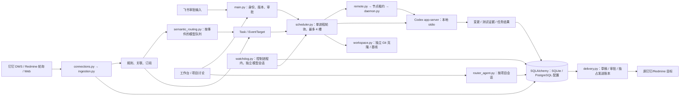

# SuperAgent 真实架构与参考方案

审计对象和环境见[证据矩阵](evidence-matrix.md)及[测试记录](test-results.md)。结论基于当前工作树快照中的代码和本轮验证，项目文档用来界定预期。当前目标是个人及受信任小团队的钉钉、Redmine、Windows 和本地 Codex 工作台；GitHub 可选，不自动上线。评分同时衡量它向通用 SuperAgent 的距离，因此会记录首版有意留在范围外的能力。

## 参考基线：区分设计、原型和生产目标

1. **设计思想。** DeepSeek Harness 团队的[中文原文](https://mp.weixin.qq.com/s/zoS7GlReWPhfCjENGxXCdg)和[官方英文发布](https://x.com/DeepSeekHarness/status/2116857257245987236)在本环境分别打不开和返回 403；设计正文通过[保留官方署名的英文转载](https://threadnavigator.com/thread/2116857257245987236/)交叉核对。第 2–6 节描述常驻协调层与隔离 Worker、规则与语义两级过滤、订阅直达、Inline & Spill/链式召回、长工具后台化、多渠道双工、状态/计算/环境分离及外部 Watchdog。文章是工程设计论证，其中的内部案例和数据不等于开源原型的承诺，也不用于本项目评分。
2. **开源原型。** 2026-11-17 读取 DeepSeek 官方仓库 `main` 的[说明](https://github.com/deepseek-ai/dsh-superagent-prototype)、[架构](https://github.com/deepseek-ai/dsh-superagent-prototype/blob/8c32a9dc5d72c033816c6a8110b37f40cf94fba4/docs/007-architecture.md)、[执行](https://github.com/deepseek-ai/dsh-superagent-prototype/blob/8c32a9dc5d72c033816c6a8110b37f40cf94fba4/docs/003-execution.md)和[部署手册](https://github.com/deepseek-ai/dsh-superagent-prototype/blob/8c32a9dc5d72c033816c6a8110b37f40cf94fba4/docs/006-deployment.md)，对照 [Engine](https://github.com/deepseek-ai/dsh-superagent-prototype/blob/8c32a9dc5d72c033816c6a8110b37f40cf94fba4/src/core/engine.ts)、[Passes](https://github.com/deepseek-ai/dsh-superagent-prototype/blob/8c32a9dc5d72c033816c6a8110b37f40cf94fba4/src/app/passes.ts)和 [Outbox](https://github.com/deepseek-ai/dsh-superagent-prototype/blob/8c32a9dc5d72c033816c6a8110b37f40cf94fba4/src/app/outbox.ts) 实现。GitHub 页面确认本轮参考提交为 [8c32a9d](https://github.com/deepseek-ai/dsh-superagent-prototype/commit/8c32a9dc5d72c033816c6a8110b37f40cf94fba4)；本轮仅审阅，未运行原型。可见能力有 Trigger→Eval→Ticket→Assignment、单事务领域写入、订阅扇出、阶段副作用队列、后台 shell/job 与结果唤醒、操作与会话复用、GitHub 及可选飞书。它有重启后恢复 Assignment 和状态目录互斥；查阅范围内未证实文章中的完整外置 Watchdog、任意远端迁移或生产级服务水平。部署文档明确说明两个角色预设以操作系统用户运行，并要求专用账号来获得隔离。
3. **审计提出的生产条件。** 至少一次收件、幂等与租约隔离、外部结果未知时不盲目重放、安全重试、应用/节点/业务进度分层健康、无业务进展的确定性保护、备份演练、代表性稳定性与负载数据。它们属于本审计的验收建议。外部接口缺少事务或供应商幂等键时，不能承诺全链路恰好一次。

## 代码结构和真实执行路径

- **控制与分派。** FastAPI 生命周期初始化数据库，先处理不确定的任务/线程及节点操作，再启动调度、渠道、语义分派和飞书处理（`main.py:28–67`）。规则路径先核验来源身份、项目、订阅和唯一键；裁决不确定时才走可选语义队列。按项目的讨论 Router 与按事件查材料的分流 Router 是两类会话，模型返回结构化动作，由平台复查版本和权限（`semantic_routing.py:132–152,222–296,320–374`）。工作台可直接对任务发后续消息，运行中 Web 追加走 `turn/steer`，失败保留消息、要求恢复（`main.py:295–339`）；外部规范化事件的追加路径通过订阅、版本更新及中断钩子（`subscriptions.py:70–122`、`connections.py:152–176`），两者不能当成同一种无中断投递。
- **执行与存储。** 控制层记录任务、状态版本、线程/轮次、工作区、审批和版本产物；实际模型历史需由 Codex 读取。当前调度的活跃集合、客户端与锁保留在进程内。远端 daemon 提供签名、随机数防重、租约、节点范围和迟到回执保护；工作区仍在控制端准备，执行节点须能访问相同路径（`scheduler.py:256–267,314–317`）。节点换代或控制面重启会把操作标为未知，不能视为远端实时接管（`execution_nodes.py:154–225`）。
- **结果与授权。** 收件 ID、任务 ID、线程/轮次和 action ID 可关联；测试门校验命令匹配、工作目录、结果状态、变更和当前版本，人工验收时再次比对差异（`runtime/evidence.py:9–55,57–129`、`main.py:403–451`）。外部回复先保存草稿、授权及账本，再尝试发送；未知状态保留，钉钉/Redmine 用渠道实际能力归因（`delivery.py:335–395`）。工作台自身构建结果不能替代 Worker 的交付证据。
- **运行中的协作。** 主任务可根据结果提出有限的只读子 Worker，人工也可显式委派分析/修复。子 Worker 结果作为事件回到父任务，尊重暂停、终态和未知状态。这是有数据库副作用的分工，尚无可核实的工件依赖和独立合并审查（`event_groups.py:62–144`、`api/event_groups.py:347–383`）。

## 对照结论

| 参考能力 | 本项目现状与证据 | 是否优先改造 |
| --- | --- | --- |
| 长驻协调与隔离 Worker | **功能等效，验证范围有限。** 规则、事件裁决、项目讨论均可与 Worker 执行隔离。工作区和会话按任务绑定。活跃状态和并发协调仍集中在一个控制进程。 | 高：先拆轮询失效域、持久化执行交接；不需先改成全球单 Router。 |
| Fast/Slow Path 和订阅直达 | **功能等效。** 显式订阅、扇出去重、按目标记录结果；外部后续常走版本更新加中断，Web 追加才走 steer。 | 中：把消息“已收件／已投递／已应用”分开，并测试队列积压。 |
| 跨渠道同一任务 | 通过明确引用、项目及订阅进行关联，回复保留原目标；真实钉钉与 Redmine 之间的持续同任务运行未验。无 Git/CI 业务触发。 | 中：先补一个真实跟进用例和确认回执。 |
| Inline & Spill、链式召回 | **部分等效。** 可按需给 Router 补历史/附件，Worker 启动注入有限摘要和近 24 条消息。H8 中旧决策仍在库，却没进入提示且无 Worker 事件查阅指针。 | 高：版本化决策摘要、按 ID 取证；先测召回正确性，再考虑向量检索。 |
| 异步工具任务 | 本项目有异步 JSON-RPC、轮次控制、超时。持久的节点 RPC 不是独立的后台 shell Job；未见 Job 完成主动唤醒同一 Worker 的等价层。 | 高：只为长命令增加持久 Job；审批释放执行槽。 |
| 持久状态与分离执行环境 | 数据库、节点租约是实装；远端路径、代码基线和模型会话仍耦合本机存储，PG 仅供应配置和脚本证据。 | 高：先验证单控制器、PG 与单节点的恢复契约，按实际需要再扩展。 |
| 外部 Watchdog | 它是控制进程内的独立模型会话，需运行同一 API 的启动生命周期。重复协议增量经过 H6 已证可续命；Compose 会尝试在进程退出后重启，但未见业务进度探针和外部针对卡住任务的自动恢复。 | 最高：进程健康、业务进度和处理异常分成三个信号。 |
| 权限、审计与不确定副作用 | **具体保护强于所查原型默认部署方式。** 本项目有角色、路径限制、版本/动作绑定和共同认可的账本；未知发送默认阻塞。原型 Outbox 有原子入队、顺序和退避，这恰是本项目应吸收的部分。 | 保留约束。不能从两种部署默认推出全面安全或更高可靠性。 |
| PR、CI 和交付核验 | 本项目以本地差异、测试和人工验收为主；原型围绕一个 GitHub repo，能作分支/PR、读取提交的 Checks 并回贴。本项目不自动上线符合首版目标。 | 中：先读真实 CI 结果并绑定审查与构建证据，不必增加自动合并。 |

## 主要失效点

1. **一个进程承担太多职责。** 启动恢复没有持久控制器所有权，`lifespan` 的批量更新假设前任已退出；`Scheduler` 持有本地锁与槽位。`poll` 还在选任务前等待自动交付，发送慢会延迟新任务。仅配置 PostgreSQL 或扩大并发不改变这些失效域。
2. **重启能冻结，不等于能继续。** H1/H9 的启动函数探针保留线程/轮次，阻断旧审批；当前并未自动回查已知无副作用的步骤，审批也不会原样复活。冻结是合理保护；应先显式划分安全可重试、不可重试和需要回查的副作用。
3. **能说话不代表在干活。** `scheduler.py:584` 几乎每个非 stderr 通知都当进度。H6 中 1 秒阈值下，2 秒以上重复增量不触发停滞。巡检与主进程共故障，而且模型结论未知时会要求人工核验；模型不适合当唯一停机保护。
4. **长历史保留，但模型看不到关键旧信息。** 初始上下文按条/按字符裁剪，先取全组后裁最后 24 条；H8 中可检索的旧决策和长消息尾部均未进入 76,034 字符提示。不能由此断言底层 Codex 从不压缩；缺的是平台可复现的预算与召回契约。
5. **验证过本地结果，不等于完成业务交付。** 无真实模型、渠道及 PR/CI 端到端证据，无独立 Review 硬门。Web 构建通过，审批深链接在全量测试找不到有效批准按钮、定向复跑通过，根因未确定；需确认慢加载、测试隔离和实际路由。布局断言重复失败，源码显示账号移到顶部；该断言失败不等于审批失效。
